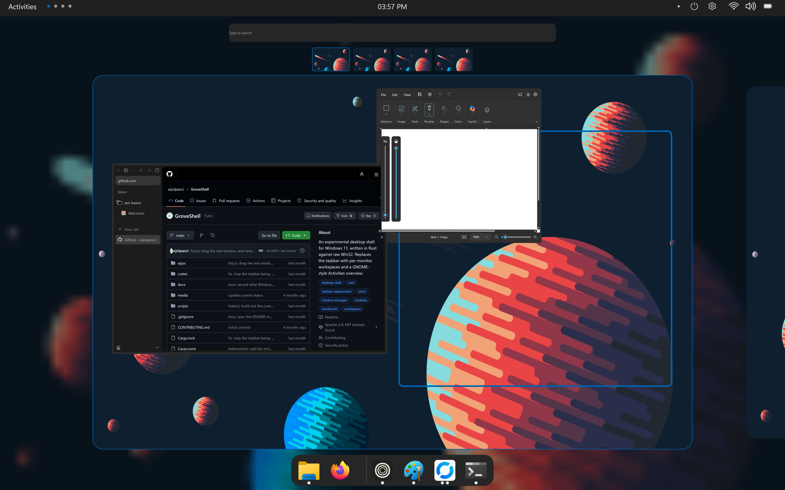

<p align="center">
  
</p>

# GroveShell

GroveShell is an experimental desktop shell for Windows 11. It hides the
taskbar and puts a top bar, per-monitor workspaces, and a GNOME-style
Activities overview in its place.

It is written in Rust against Win32 and runs alongside Explorer. Quitting
it restores the Windows taskbar and your windows. Because it is
experimental, keep the [recovery instructions](#recovery-and-diagnostics)
handy when you try a new build.


## Activities and workspaces

Tap the Windows key to open Activities. The overview shows the current
workspace with a live preview of each window, a strip of workspace
thumbnails above it, a search field, and a dock with your pinned and
running apps. Click a preview to focus that window, type to search, or drag
a preview onto another workspace.



Each monitor has its own set of workspaces, so switching on one display
leaves the others alone. The last workspace in the set is always empty.
When you connect or disconnect a monitor, GroveShell moves the affected
windows into a workspace you can reach.

## Motion

Opening and closing Activities is one continuous motion, not a fade on a
fixed timer. Each window travels from where it sits on screen into its slot
in the grid, the dock slides up from below, and the thumbnail strip drops in
from above. You can stop the motion halfway and reverse it.

A two-finger touchpad scroll or the mouse wheel drives the overview
transition and the workspace carousel, and a fling lands where its momentum
carries it. Every animated surface is computed from one progress value per
monitor, which is why the pieces stay in step. The
[motion design notes](docs/design/2026-10-13-gnome-motion-port-design.md)
explain the approach.

## Top bar

Every monitor gets an Activities button and workspace indicators. The
primary display also has a clock and calendar, system status, settings, a
power menu, and access to the Windows notification area.


### Control center

The control center has tiles for Wi-Fi, Bluetooth, appearance, and radios,
plus mute and a draggable volume slider. The arrow on each split button
opens more options: a Wi-Fi network list with saved connections, Bluetooth
pairing, themes, Windows airplane mode, audio devices, and the volume mixer.


You pick a saved Wi-Fi network inside GroveShell. The list shows signal
strength and supports disconnect, refresh, and scrolling. Setting up a new
network and entering its password go through Windows' own connection UI.
GroveShell does not collect or store Wi-Fi passwords.

The panel uses Segoe UI, rounded surfaces, and the Windows accent color. It
shows hover and keyboard focus, and its fade transitions respect reduced
motion. Radio operations run in the background so they do not block
painting.

Keyboard control:

- Tab moves between controls.
- Enter or Space activates the focused control.
- The arrow keys adjust the volume slider when it has focus.
- Escape goes back from an options page, or closes the panel.

### Notification area

GroveShell captures the promoted notification icons before it hides
Explorer's taskbar and shows them in the primary bar. Left-click invokes the
app, right-click requests its context menu, and the chevron opens Windows'
hidden icons.

Windows 11 stops rendering its XAML tray while the taskbar is hidden, so the
inline images keep their last captured appearance. New icons and badge
changes need another capture while Explorer's taskbar is visible, or a shell
restart.

## Settings

The gear in the top bar opens settings for bar height, dock placement and
behavior, overview appearance, input, and accessibility. The dock can appear
only in the overview, stay visible on the desktop, or auto-hide on the
desktop. Appearance changes apply while GroveShell is running.

The shell follows the Windows accent color and supports high contrast,
reduced motion, and per-monitor DPI scaling. Compatibility rules can exclude
apps from workspace management. The
[compatibility notes](docs/compatibility.md) list the tested configurations
and the hardware checks still to do.

## Keyboard and mouse

| Action | Shortcut |
| --- | --- |
| Open or close Activities | Tap the Windows key |
| Switch workspace on the focused monitor | Ctrl + Alt + Left / Right |
| Move the focused window to another workspace | Ctrl + Alt + Shift + Left / Right |
| Move a window | Windows key + left-drag |
| Resize a window | Windows key + right-drag |
| Search apps and windows | Type in Activities; Enter opens the top result |
| Open Activities with the mouse | Click Activities or use the top-left hot corner |

## Build and run

You need Windows 11 x64 and Rust stable with the MSVC toolchain, plus the
Windows SDK and the Visual Studio C++ build tools.

```powershell
cargo build --workspace
cargo test --workspace
.\scripts\dev-start.ps1
```

`dev-start.ps1` builds the workspace and starts the watchdog, host, and UI
in the background. It then shows a dashboard with process status and a
graceful shutdown command. Use graceful shutdown to restore the taskbar,
work areas, and parked windows.

## Recovery and diagnostics

If the shell becomes unresponsive, run:

```powershell
.\scripts\recover.ps1
```

The script stops GroveShell processes and makes sure Explorer is running. It
does not depend on a working GroveShell binary. Starting GroveShell, or
quitting it gracefully, also repairs a taskbar left hidden by a hard kill.

The host and watchdog monitor process health. Structured, rotating logs are
written to `%LOCALAPPDATA%\GroveShell\logs\`. The CLI has `ping`,
`shutdown`, `list-windows`, `list-monitors`, and `diagnostics` commands, and
`diagnostics` can redact window titles. Telemetry is off by default.

## Current limitations

- Workspace assignments do not persist across restarts.
- The radio tile switches the available radios together. It is not Windows'
  airplane-mode flag; its options page opens the actual Windows setting.
- Brightness, Night Light, and Do Not Disturb are not integrated controls.
- Tray images are snapshots, and app menu behavior varies across Explorer
  builds.
- Wi-Fi enumeration can require Windows location permission. If it is
  denied, the panel still gives access to Windows' network UI.
- Three-finger touchpad swipes are not supported.
- Testing with Narrator, on mixed-monitor hardware, and over long sessions
  is not finished. Painted keyboard controls do not yet expose a complete UI
  Automation accessibility tree.

## Development

[CONTRIBUTING.md](CONTRIBUTING.md) covers how to contribute.
[The design document](docs/PROJECT_PLAN.md) describes the architecture and
future work, and the [architecture decisions](docs/adr/) record the
reasoning behind the design.

GroveShell takes workflow inspiration from GNOME Shell, using no GNOME code,
assets, or branding. It is not affiliated with or endorsed by the GNOME
Foundation. Interface icons are from [Lucide](https://lucide.dev), with their
license included in `crates/ui-kit/resources/icons/NOTICE.md`.

Dual-licensed under [Apache-2.0](LICENSE-APACHE) or [MIT](LICENSE-MIT).
